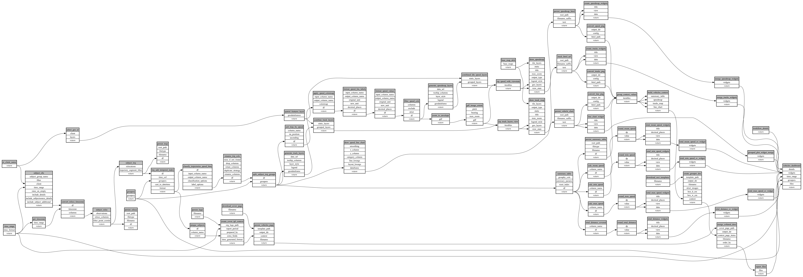

```
# AUTOGENERATED BY ECOSCOPE-WORKFLOWS; see fingerprint in README.md for details

```

```yaml
# fingerprint:
artifacts_sha256_basic: 79b58bab75e927c829f2ef640852a47598403a639320619d577105f71528943f
artifacts_sha256_strict: d1fd181cfc91b0c4c5c7bd32040f369d37d53bba8aa6de118a89579846daeec0
installed_requirements:
- channel: https://repo.prefix.dev/ecoscope-workflows/
  name: ecoscope-platform
  version: {version: ==2.28.0}
- channel: https://repo.prefix.dev/ecoscope-workflows-custom/
  name: ecoscope-workflows-ext-custom
  version: {version: ==0.1.4}
- channel: https://repo.prefix.dev/ecoscope-workflows-custom/
  name: ecoscope-workflows-ext-ste
  version: {version: ==0.0.28}
- channel: https://repo.prefix.dev/ecoscope-workflows-custom/
  name: ecoscope-workflows-ext-lion-guardians
  version: {version: ==0.0.9}
- channel: conda-forge
  name: pydeck
  version: {version: ==0.9.2}
- channel: conda-forge
  name: opentelemetry-sdk
  version: {version: ==1.45.2}
params_sha256: f6786547988bc76da2ae0963fcb3be24c23f3a531b0be60e60e823ae87500854
spec_sha256: 7febca8a2045b02df69bf7212997ba0fd9aab0f18230e3e2cfa7a8e3ca0e1447

```

# ecoscope-workflows-vehicles-report-workflow


